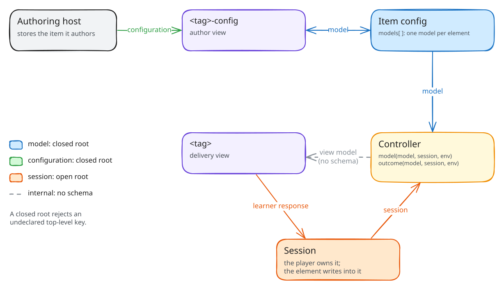
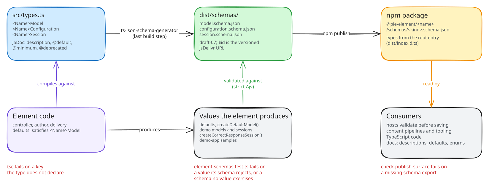

# Element Interfaces and JSON Schemas

Every element package declares its data contract as TypeScript interfaces in `src/types.ts` and publishes JSON Schemas generated from them. The interfaces type the element's own code and TypeScript hosts. The schemas let hosts, content pipelines and tooling validate and read element data without TypeScript. One declaration produces both, so they cannot drift.

The decision record is the [Element JSON Schemas PRD](prds/element-json-schemas/PRD.md) ([PIE-1255](https://illuminate.atlassian.net/browse/PIE-1255)). The packaging rules are normative in [PIE Element Contract: JSON Schemas](PIE_ELEMENT_CONTRACT.md#json-schemas).

## Contracts

| Contract | Holds | Interface | Export | Root |
| --- | --- | --- | --- | --- |
| Model | The authored data for one element in an item: stored in the item config, read by the controller and both views | `<Name>Model`, extending `PieModel` | `./schemas/model.schema.json` | closed |
| Configuration | What the author view offers an author: settings-panel switches, editor toolbars, limits. The authoring host sets it | `<Name>Configuration` | `./schemas/configuration.schema.json` | closed |
| Session | The learner's response. The player owns the object and the element writes into it | `<Name>Session` | `./schemas/session.schema.json` | open |

`<Name>` is the PascalCase package name: `@pie-element/multiple-choice` declares `MultipleChoiceModel`, `MultipleChoiceConfiguration` and `MultipleChoiceSession`. 31 element packages publish model and session schemas. 30 also publish configuration; `match-list` has no authoring view.



The controller's `model(model, session, env)` turns the model into the view model the delivery view renders. The view model is internal to the element, has no schema, and is never stored.

A closed root reports an undeclared top-level key, so validating a model that carries a misspelled `choicePrefx` returns an error. Nested objects stay open, so a misspelling inside a choice passes. The session root stays open because players and controllers write extra state into the session.

## Declaring the Contract

### Types

`src/types.ts` exports the three interfaces. The model extends `PieModel` from `@pie-element/shared-types`, which supplies `id`, `element` and `accessibilityCatalogs`. Configuration shapes compose the shared authoring types in the same package, so every element describes a settings switch or an editor toolbar the same way:

| Type | Describes |
| --- | --- |
| `ConfigureProp`, `ConfigurePropWithEnabled` | A settings-panel control: `settings` and `label`, plus `enabled` for a switch whose value changes the author view |
| `EditableHtmlConfigureProp` | The toolbar plugins of one rich-text field, including custom plugins |
| `EditableHtmlPluginConfigure`, `EditableHtmlPluginConfigureRequired` | A rich-text field's settings control and `inputConfiguration`, plus `required` |
| `ConfigureMaxImageDimensionsProp`, `ConfigureMathMLProp`, `ConfigureLanguageOptions`, `ContentDimensions` | Image limits per field, MathML output and editing, language choices, and the author container's size |
| `CommonConfigSettings` | The settings every configuration may carry, which `validate()` also receives |

The package root re-exports the types with `export type * from './types.js'`.

The reference shapes are `multiple-choice` (React) and `venn-classification` (Svelte). An excerpt from `packages/elements-react/multiple-choice/src/types.ts`:

```ts
/** Model for the Choice Interaction */
export interface MultipleChoiceModel extends PieModel {
  /**
   * What key should be displayed before choices: `none` displays no key.
   * @default "letters"
   */
  choicePrefix?: 'letters' | 'numbers' | 'none';
  /** The choice options for the question */
  choices: Choice[];
  /** @deprecated Use `choicesLayout`; `false` reads as `horizontal`. */
  verticalMode?: boolean;
}
```

generates:

```json
"choicePrefix": {
  "type": "string",
  "enum": ["letters", "numbers", "none"],
  "description": "What key should be displayed before choices: `none` displays no key.",
  "default": "letters"
},
"verticalMode": {
  "type": "boolean",
  "deprecated": true,
  "description": "Deprecated: Use `choicesLayout`; `false` reads as `horizontal`."
}
```

with `choices`, `id` and `element` in the root's `required`.

### JSDoc

| In `types.ts` | In the schema |
| --- | --- |
| Comment text | `description` |
| `@default <json>` | `default`: write it as JSON, `"letters"`, `2` or `true` |
| `@minimum`, `@maximum` and the other JSON Schema keywords ts-json-schema-generator reads | The same keyword |
| `@deprecated <reason>` | `deprecated: true`, with `Deprecated: <reason>` appended to the description |
| A property without `?` | An entry in `required` |
| A string-literal union | `enum` |

Hosts, authoring tools and documentation show the description, so it states what the key does, its units, and what an absent key means. `@default` is the value the element's defaults supply. A package name in a comment sits in backticks: TypeScript reads a bare `@scope/name` as a tag and drops the rest of the description, so generation fails on one.

### Packaging

The `exports` map decides which schemas generate: each `./schemas/<kind>.schema.json` entry generates from the matching interface. Configuration is omitted only when the package has no `./author` export. Generation is the last step of the build:

```json
"exports": {
  "./schemas/model.schema.json": "./dist/schemas/model.schema.json",
  "./schemas/configuration.schema.json": "./dist/schemas/configuration.schema.json",
  "./schemas/session.schema.json": "./dist/schemas/session.schema.json"
},
"scripts": {
  "build": "… && bun x tsc --emitDeclarationOnly && bun ../../../tools/schemas/build.ts"
}
```

`tools/schemas/build.ts` writes `dist/schemas/<kind>.schema.json`: draft-07, with `$id` set to the versioned jsDelivr URL. Shared shapes sit in each schema's own `definitions`, so a schema references no other file. Schemas are build output and are not committed.

### Typed Element Code

The controller, author view, delivery view and defaults compile against the interfaces, so `tsc` rejects code that reads or writes a key the interface does not declare. Default objects use `satisfies`, which checks the object against the interface without widening it. The model defaults omit `id` and `element`, which the item config and the player supply:

```ts
const model: Omit<VennClassificationModel, 'id' | 'element'> = { … };

export default {
  model,
  configuration: { … } satisfies VennClassificationConfiguration,
};
```

Typing changes no behaviour. A key that stored content carries and the element no longer reads stays declared, with a comment saying it is not read, because removing it from a closed root makes that content fail validation. Differences from the legacy `pie-elements` schemas are recorded in [Legacy contract changes](prds/element-json-schemas/notes/legacy-contract-changes.md).

### Changing a Contract

Element-specific fields are public once published and follow semver. Adding an optional key is additive. Removing or renaming a key, making an optional key required, or narrowing a type is breaking, because content that validated against the previous schema fails the new one. A key the element stops reading stays declared, marked `@deprecated` when authors should stop writing it.

## Gates

| Gate | Fails on | Runs in |
| --- | --- | --- |
| `tsc`, in each package build | Element code or defaults using a key the interface does not declare | CI and the pre-push gate |
| `tools/schemas/element-schemas.test.ts` | A schema that does not compile under strict Ajv; a value the element produces that its schema rejects; a declared schema no value exercises | `bun run test`, in CI and the pre-push gate |
| `scripts/check-publish-surface.mjs` | An element package without its schema exports | `bun run verify:element-contracts`, before every release publish |

The schema test validates the values each element ships:

- the controller defaults and `createDefaultModel()`;
- the author defaults;
- the demo models and sessions in `docs/demo/config.mjs` and `docs/demo/session.mjs`;
- the session `createCorrectResponseSession()` returns for each demo model, in gather mode as instructor;
- the samples in `apps/element-demo` and `apps/element-a11y-demo`.

A failure names the value and the Ajv error. One element's schemas run alone with:

```bash
bun run test tools/schemas -t multiple-choice
```



## Using the Schemas

### Resolving

Each schema ships in its npm package and resolves from jsDelivr at its `$id`:

- npm: `@pie-element/multiple-choice/schemas/model.schema.json`
- jsDelivr: `https://cdn.jsdelivr.net/npm/@pie-element/multiple-choice@<version>/dist/schemas/model.schema.json`

The `$id` carries the package version, so a schema names the exact element release it describes. Schemas publish from the first release of each element that includes [PIE-1255](https://illuminate.atlassian.net/browse/PIE-1255).

### Validating

```js
import Ajv from 'ajv';
import schema from '@pie-element/multiple-choice/schemas/model.schema.json' with { type: 'json' };

const validate = new Ajv({ allowUnionTypes: true, allErrors: true }).compile(schema);

function checkModel(model, { strict = false } = {}) {
  if (validate(model)) return;
  if (strict) throw new Error(`invalid multiple-choice model: ${JSON.stringify(validate.errors)}`);
  console.warn('multiple-choice model', validate.errors);
}

checkModel({ id: '1', element: 'multiple-choice', choices: [], choicePrefx: 'letters' });
// warns: validate.errors[0].params.additionalProperty is "choicePrefx"
```

Both modes run the same validator; the host decides what an error means. Validate leniently by default, so content an element renders is never denied, and use the warnings to find unknown keys and unexpected values. Validate strictly where the host controls what it accepts, such as an authoring tool saving a new model. `allErrors` makes a lenient run report every failure, where Ajv otherwise stops at the first.

`allowUnionTypes` keeps Ajv's strict mode quiet about multi-type keywords such as `"type": ["string", "number"]`, which 39 of the 92 published schemas contain.

Validate a model against the schema of the element version that renders it. A key added in a later release fails an earlier schema's closed root.

Validation is structural. Whether a model is authorable, for example whether a correct answer is marked, is the controller's `validate(model, config)`, which returns authoring errors.

Elements, players and `pie-api-aws` do not validate against the schemas: a host validates where it accepts or stores content. `pie-api-aws` stores models as given and checks only request envelopes. Content it serves today predates the schemas and fails strict validation, so validate it leniently: its Learnosity transform writes keys no ng schema declares, such as `weights` on multiple-choice and `published` on extended-text-entry, and authored items carry other value shapes, such as an empty `alternateResponse` array on inline-dropdown.

### TypeScript

```ts
import type { MultipleChoiceModel, MultipleChoiceSession } from '@pie-element/multiple-choice';
```

The import is type-only and adds nothing to a bundle.

### Reading the Contract

A schema is also the element's data reference. `description` says what a key does, `default` the value the defaults supply, `enum` the allowed values, `required` what the element cannot render without, and `deprecated` what to stop writing. JSON Schema tooling, such as editor completion, documentation viewers and form generators, reads the files as published.

The element demo's docs pages render the same schemas: a Model, a Configuration and a Session section per view, with each element's defaults beside every property. [Docs generation](SCHEMA_GENERATION.md) describes how the pages are built.
